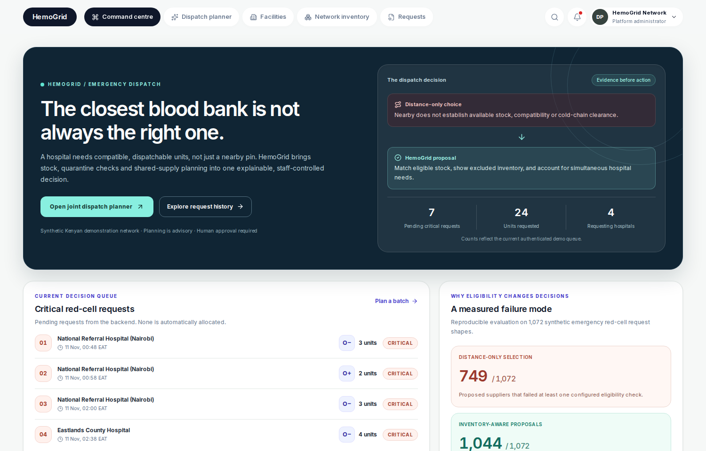

<!--
  Publication source for Team-Relay/.github/profile/README.md.
  The public organization profile is a PROJECT INTRODUCTION, not the official
  technical-phase submission README. Once the screenshot exists, copy the
  contents of this file into the special .github repository's profile/README.md.
-->

# HemoGrid

### The closest blood bank is not always the right one.

**Emergency request & dispatch · Team Relay · Terumo BCT Africa Hackathon 2026**

**[Launch the working demo](https://hemogrid-eight.vercel.app/login)** · **[Judge's quick guide](https://github.com/Team-Relay/hemo-grid-frontend/blob/main/docs/JUDGE_START_HERE.md)** · [Frontend](https://github.com/Team-Relay/hemo-grid-frontend) · [Backend](https://github.com/Team-Relay/hemo-grid-backend)

**No signup.** Choose **Hospital**, **Blood bank** or **Platform admin**. The synthetic email and password are **prefilled**. Click **Continue to workspace**; do not use your personal credentials.

Actual hosted Network Mission Control workspace · Synthetic demonstration data, not real patient records.

---

## A working dispatch decision, not just a map

A nearby bank may lack **eligible, dispatchable blood**. HemoGrid connects a hospital's request, a coordinator's shared-stock plan and the supplying bank's approval and reservation.

**Proven on the deployed synthetic system:** A hospital created a one-unit A-positive request, selected a bank, and the bank accepted, reserved, prepared, marked in transit and completed delivery. Inventory reconciled from **10 → 9 available units**, with **0 reserved** at completion.

**[View the hosted transaction audit](https://github.com/Team-Relay/hemo-grid-frontend/actions/runs/42952475072)** · [Review reproducible evaluation and limitations](https://github.com/Team-Relay/hemo-grid-backend#ai-and-data)

## What judges can explore

| Hospital officer | Network coordinator | Supplying blood bank |
| :--- | :--- | :--- |
| Record a request and review eligible suppliers | Compare joint allocation proposals for 2–5 staff-approved critical red-cell requests | Accept, reserve, prepare, dispatch and complete a synthetic order |

**Each action has a responsible human.** Coordinator previews do not reserve stock, and the system does not claim clinical clearance or actual transport time.

## Two codebases. One project.

| Start here | Technical contribution |
| --- | --- |
| **[Primary submission README and frontend](https://github.com/Team-Relay/hemo-grid-frontend#readme)** | User workflow, setup, authentication experience, API integration and browser tests |
| **[Backend engineering README](https://github.com/Team-Relay/hemo-grid-backend#readme)** | Spring Boot API, PostgreSQL transactions, inventory safeguards, planner, reproducible benchmarks and limitations |

**For reviewers:** This organization page is a short introduction. The required technical README structure is in the **root README files linked above**. Read the [two-minute judging guide](https://github.com/Team-Relay/hemo-grid-frontend/blob/main/docs/JUDGE_START_HERE.md) for the demonstration order, architecture, baseline comparisons and evidence.

## Team Relay

**Grold Otieno** · AI/ML research; Epidemiology and Biostatistics · Kenya  
**Dennis Ikechukwu Okwuchukwu** · Team lead; full-stack and systems engineering · Nigeria  
**Mubarak Zubair** · Product management and clinical data analysis · Nigeria

Prototype with synthetic Kenyan data. Not for clinical use. No real donors, patients, transfusion outcomes, measured delivery times or certified interoperability are claimed.
